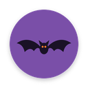
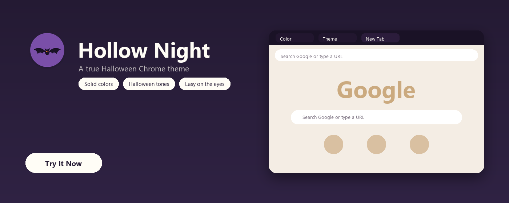
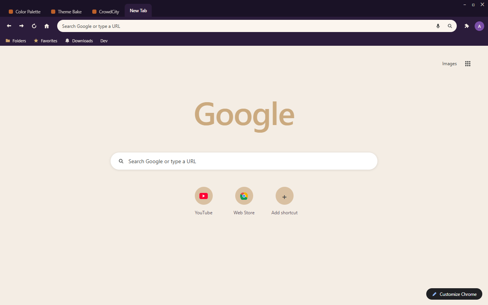
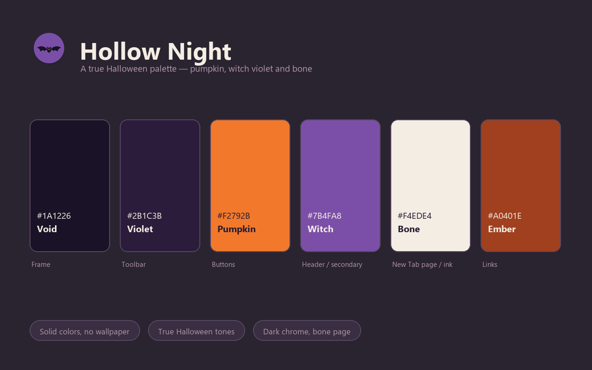

<p align="center">
  
</p>

<h1 align="center">Hollow Night Theme</h1>

<p align="center">
  A true Halloween Chrome theme in violet black, pumpkin orange and bone white.
</p>

<p align="center">
  
  
  
  
</p>

<p align="center">
  
</p>

## Overview

Hollow Night is the Halloween theme with the lights off: a violet-black frame, a slightly lifted violet toolbar, and a bone-white New Tab Page where a muted gold Google logo sits like candlelight. Bone ink keeps every tab, bookmark and toolbar icon readable on the dark chrome, pumpkin orange takes the buttons, witch violet the secondary highlights, and links fall back to a deep ember so the page never shouts.

## Design Concept

The palette is a deliberate three-way split: violet black for structure, bone for light, pumpkin orange for the one warm accent that makes it read as Halloween. Violet and orange sit opposite on the wheel, so they read as contrast rather than competition — the orange only appears in small doses (buttons, the logo, the badge mark), which keeps the theme classy instead of costume-like.

| Color | Hex | RGB | Role |
|---|---|---|---|
| Void | `#1A1226` | 26, 18, 38 | Frame |
| Violet | `#2B1C3B` | 43, 28, 59 | Toolbar |
| Pumpkin | `#F2792B` | 242, 121, 43 | Buttons |
| Witch | `#7B4FA8` | 123, 79, 168 | New Tab header / secondary buttons |
| Bone | `#F4EDE4` | 244, 237, 228 | New Tab background / chrome ink |
| Ember | `#A0401E` | 160, 64, 30 | New Tab links |
| Ink | `#241A33` | 36, 26, 51 | New Tab text |

## Features

- Pure color, no wallpaper — fast and distraction-free
- Real Halloween palette: violet black, pumpkin orange, witch violet and bone
- Dark violet chrome with bone ink — 15:1 on the frame
- Tab text, bookmark text and toolbar icons all share the same bone ink
- Single-row shortcut row and a color-matched Google logo for a clean New Tab Page
- No configuration needed — install and enjoy

## Screenshots

| Browser | Palette |
|:-:|:-:|
|  |  |

## Installation

### Load unpacked (development)

1. Download or clone this repository.
2. Open `chrome://extensions` in Chrome.
3. Enable **Developer mode** in the top right.
4. Click **Load unpacked** and select this folder (`hollow-night-theme`).
5. The theme is active immediately.

### Package for the Chrome Web Store

```
chrome://extensions → Pack extension → select this folder → hollow-night-theme.zip
```

Upload the resulting `.zip` to the [Chrome Web Store developer dashboard](https://chrome.google.com/webstore/devconsole).

## Store listing copy

Ready to paste into the store listing (also kept in `store-assets/store-description.txt`):

> Hollow Night is a true Halloween Chrome theme: violet-black chrome, a bone-white New Tab Page, and a muted gold Google logo that glows against it. Bone ink keeps every tab, bookmark and toolbar icon readable on the dark frame, with pumpkin orange and witch violet as accents. Solid colors only, no wallpaper.

## Project structure

| File | Purpose |
|---|---|
| `manifest.json` | Theme definition (single-file, inlined `theme` field) |
| `logo/logo.png` | 128×128 store icon (transparent background) |
| `store-assets/promo/440x280.png` | Small promo tile |
| `store-assets/promo/1400x560.png` | Marquee promo tile |
| `store-assets/screenshots/en/screenshot-1-browser.png` | Browser mockup screenshot (1280×800) |
| `store-assets/screenshots/en/screenshot-2-palette.png` | Palette introduction screenshot (1280×800) |
| `store-assets/store-description.txt` | Store listing description |
| `scripts/generate-logo-vector.py` | Render all SVG logo candidates with headless Chromium, export `logo/logo.png` from `SELECTED` |
| `scripts/generate-screenshot-headless.py` | Regenerate the browser mockup via Playwright |
| `scripts/generate-screenshot-2-palette.py` | Regenerate the palette screenshot |
| `scripts/generate-promo.py` | Regenerate both promo tiles (1400×560 window hero, 440×280 dot palette) |
| `LICENSE` | Non-Commercial License (English / 中文) |

## Regenerating assets

Every asset is code-generated, so nothing here is hand-drawn or hand-copied:

```bash
py -3 scripts/generate-logo-vector.py         # candidates + logo/logo.png
py -3 scripts/generate-screenshot-headless.py # store screenshot 1 (browser mockup)
py -3 scripts/generate-screenshot-2-palette.py # store screenshot 2 (palette)
py -3 scripts/generate-promo.py               # promo 440x280 + 1400x560
```

To ship a different icon candidate, change `SELECTED` at the top of `generate-logo-vector.py` and re-run, then re-run the three asset scripts so the promo and screenshots pick up the new logo.

## License

Hollow Night Theme is released under the Non-Commercial License. See `LICENSE` for full text (English / 中文).
